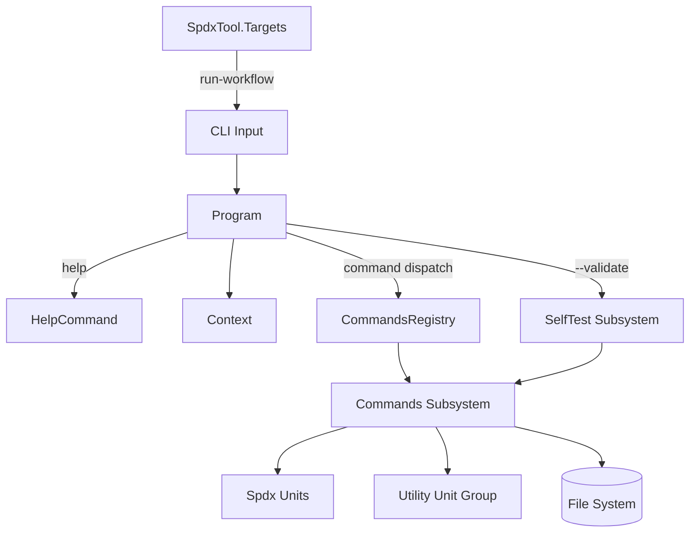

# SpdxTool

## Architecture

DemaConsulting.SpdxTool is a cross-platform .NET tool distributed as a NuGet package that
exposes a command-line interface for creating, validating, and manipulating SPDX documents.
The companion system DemaConsulting.SpdxTool.Targets integrates SPDX decoration into the
dotnet pack workflow via MSBuild targets and is described in the SpdxTool.Targets system design.

The system follows a command-pattern architecture. Program first offers the arguments to
HelpCommand, which answers the `help` command from the built-in help cards. Otherwise Program
parses global flags and constructs a Context, then dispatches to CommandsRegistry. Each registered
command is a self-contained Command subclass. The --validate global flag bypasses command dispatch
and redirects execution to the SelfTest subsystem instead.

The Commands subsystem contains one Command subclass per supported CLI subcommand: AddPackage,
AddRelationship, CopyPackage, Diagram, FindPackage, GetVersion, Hash, Help, Print, Query,
RenameId, RunWorkflow, SetVariable, ToMarkdown, UpdatePackage, and Validate. The Spdx units
provide SpdxHelpers and RelationshipDirection. The Utility unit group provides PathHelpers and
Wildcard. The SelfTest subsystem exercises every registered command against embedded SPDX fixtures.

Unit design files for all Commands subsystem units are in the commands subfolder. See also Context
Design, Program Design, and HelpCommand Design for the system-level units.

## External Interfaces

**Command-Line Interface**: The tool is invoked as `spdx-tool [options] <command> [arguments]`.
Global options (-h/-?/--help, -v/--version, -s/--silent, -l/--log, --validate, -r/--result, --depth) are parsed by
Program before command dispatch; arguments following the command name are forwarded to the selected
command.

- *Type*: Process entry point.
- *Role*: Provider.
- *Contract*: Accepts the `help` command as the first argument (see *Help Command* below), or
  global options followed by a command. Each registered command name maps to exactly one Command
  implementation; unrecognized command names are reported as errors and usage information is
  printed. The usage information ends with a pointer to the help command.
- *Constraints*: Global options must precede the command name on the command line. Option errors
  are found before `--silent` and `--log` take effect, so they are always printed and never logged.

**Help Command**: Built-in help, answered from help cards embedded in the tool assembly.

- *Type*: CLI.
- *Role*: Provider (the tool answers the `help` command from the shell).
- *Contract*: `spdx-tool help` prints the topic index, `spdx-tool help <topic>` prints a topic
  card with its examples, and `spdx-tool help commands <command>` prints the card of a command;
  HelpCards adds `--example`, `--search`, and `--json`. Returns exit code 0 for success, 2 for a
  wrong help argument or an unknown topic, and 70 for a defective card catalog.
- *Constraints*: `help` must be the first argument. It is answered before the options are parsed,
  so `--silent` and `--log` do not apply and no banner is printed. After global options, `help`
  reaches the command dispatcher as the workflow-only Help command, which reports a usage error.

**Program.Version**: A public static `string` field on Program that exposes the assembly's
informational version, read from the `AssemblyInformationalVersionAttribute` at startup.

- *Type*: Programmatic identifier.
- *Role*: Provider.
- *Contract*: Returns a non-null semantic version string (e.g., `1.2.3` or `1.2.3-preview`);
  falls back to `"Unknown"` when no attribute is present.
- *Constraints*: Read-only; the value is determined at startup and does not change during
  execution.

**File System**: Commands read SPDX JSON documents and YAML workflow files from caller-supplied paths
and write modified SPDX JSON documents back to specified output paths.

- *Type*: External storage.
- *Role*: Consumer and provider.
- *Contract*: Input SPDX files must conform to SPDX 2.x JSON format; YAML workflow files must conform
  to the step schema recognized by the RunWorkflow command.
- *Constraints*: Paths within NuGet-embedded workflows are validated by PathHelpers.SafePathCombine;
  path traversal sequences are rejected with ArgumentException.

**NuGet Cache**: The run-workflow command resolves workflow files embedded in NuGet packages from the
local NuGet cache using the package ID and version declared in the workflow step.

- *Type*: External storage.
- *Role*: Consumer.
- *Contract*: The requested package must be present in the local NuGet cache; a cache miss triggers
  an automatic package restore.
- *Constraints*: Cache miss recovery requires network access and the NuGet feed to be reachable.

**HTTP/Network**: The run-workflow command can load workflow files directly from URLs when the
url field is specified in a workflow step.

- *Type*: External service.
- *Role*: Consumer.
- *Contract*: The URL must return a valid YAML workflow file; when an integrity field is
  provided it must contain the SHA-256 hash of the response body.
- *Constraints*: Network access is required; if the URL is unreachable the step fails with a
  command error.

**MSBuild Integration**: The companion DemaConsulting.SpdxTool.Targets system injects a
DecorateSbomTarget MSBuild target that invokes spdx-tool run-workflow after dotnet pack. The tool
must be installed as a .NET tool in the build environment for the target to succeed.

- *Type*: Build-system integration.
- *Role*: Provider (tool executable consumed by the Targets system).
- *Contract*: The tool must accept the run-workflow command with the workflow file path supplied by
  the MSBuild target property.
- *Constraints*: The Targets system is a separate deployment unit; see the SpdxTool.Targets system
  design for full details.

## Dependencies

- **DemaConsulting.SpdxModel** - SPDX 2.x document object model, JSON serialization, and
  deserialization via Spdx2JsonSerializer and Spdx2JsonDeserializer. See *SpdxModel Integration Design*.
- **DemaConsulting.NuGet.Caching** - local NuGet cache resolution used by the run-workflow command
  to locate NuGet-embedded workflow files. See *NuGetCaching Integration Design*.
- **DemaConsulting.TestResults** - test result writing for the self-validation suite; supports TRX
  and JUnit XML output formats. See *TestResults Integration Design*.
- **YamlDotNet** - YAML parsing for workflow files and per-step command argument nodes.
  See *YamlDotNet Integration Design*.
- **DemaConsulting.HelpCards** - loads, validates, and serves the built-in help cards for the
  `help` command. See *HelpCards Integration Design*.

## Risk Control Measures

N/A - not a safety-classified software item.

## Data Flow

1. The user invokes `spdx-tool` at the command line. Program first offers the arguments to
   `HelpCommand.TryRun`. When the first argument is `help`, the help command builds the card
   catalog, writes its answer to the console, and `Main` returns its exit code. Any other first
   argument returns at once without building the catalog.
2. Program parses global flags and constructs a
   Context carrying the flag state, an optional log writer, and an error counter. If `--silent` is
   specified, `Context.Silent` is set to `true`, which suppresses all `context.WriteLine` and
   `context.WriteError` calls from writing to the console. If `--log <file>` is specified,
   `Context.LogWriter` is set to a `StreamWriter` for that file, and all output is duplicated to
   the log file regardless of the silent state. If `Context.Create` throws
   `InvalidOperationException` (for example, when `--log` is specified without a following
   argument, or `--depth` receives an invalid or negative value), `Main` writes
   `Error: {message}` in red directly to the console, resets the console color, and returns 1.
   This failure path does not construct a `Context` and does not return through `Run`.
3. If the argument list is empty and --validate was not set, Program records an error
   ('Error: Missing arguments') and prints usage information; execution terminates with exit code 1.
4. If --validate is set, execution is redirected to SelfTest.Validate.Run, which exercises every
   registered command against embedded SPDX fixtures and writes results to the validation file if
   one was specified.
5. Otherwise, Program looks up the command name in CommandsRegistry.Commands and calls
   Command.Run(context, args) on the matched entry; an unrecognized name produces an error and
   prints usage information.    CommandUsageException is caught, reported as `Error: {message}`, and usage information
   is printed; CommandErrorException is caught and reported as `Error: {message}` without
   printing usage. Any other unexpected exception from command execution is
   caught by the catch-all handler and reported via context.WriteError using ex.ToString(),
   which includes the full stack trace, to aid debugging of unexpected failures in CI environments.
6. The selected command reads any required SPDX JSON documents from the file system via
   SpdxHelpers.LoadJsonDocument, and YAML workflow files via YamlDotNet.
7. The command applies the requested transformation or query using SpdxHelpers, PathHelpers, and
   Wildcard as needed; variable tokens in YAML values are expanded by Command.Expand at execution
   time.
8. Modified SPDX documents are serialized to JSON and written to the output path by
   SpdxHelpers.SaveJsonDocument, which stamps the document with the tool creator entry.
9. Context.ExitCode returns 1 if any errors were recorded during execution; `Main` returns
   `Context.ExitCode`, which becomes the process exit code.

## Design Constraints

- **Cross-platform**: The tool targets .NET 10 and 11 and must run on Windows, Linux, and
  macOS; all file path operations use System.IO.Path APIs to maintain portability.
- **No global state**: All mutable runtime state is encapsulated in Context and passed explicitly;
  Command subclasses are stateless.
- **Workflow isolation**: Each workflow step executes within the same Context instance; variables
  maintained by RunWorkflow are passed as a dictionary parameter across step boundaries.
- **Self-contained validation**: The --validate flag runs the full command suite in-process using
  embedded SPDX fixtures; only the ValidateQuery step (spawns dotnet) and the
  ValidateRunNuGetWorkflow step (may restore a NuGet package) require resources outside the
  process.
- **Variable substitution**: `${{ name }}` tokens in YAML values are resolved by Command.Expand
  at step-execution time using the current workflow variable map. Tokens using the
  `${{ environment.NAME }}` prefix are resolved against the current process environment instead.
  Variable names that cannot be resolved from either source throw InvalidOperationException.
- **Path safety**: NuGet-embedded workflow paths are validated by PathHelpers.SafePathCombine
  before use; paths containing ".." components or absolute roots are rejected with
  ArgumentException.
